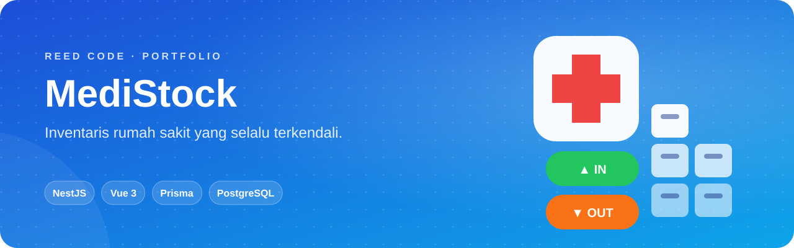
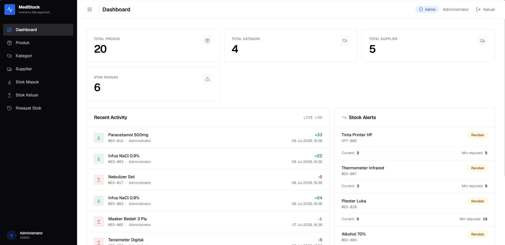
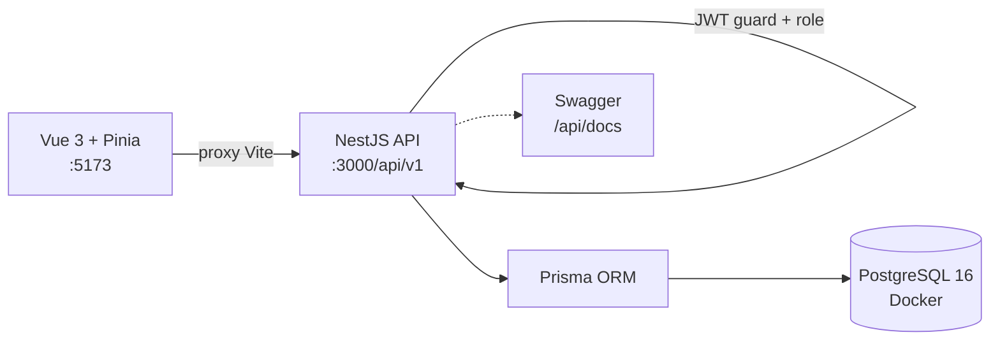

<p align="center">
  
</p>

<p align="center">
  <b>Stok obat dan alat kesehatan yang selalu terpantau.</b> Sistem inventaris rumah sakit untuk mencatat barang masuk-keluar, supplier, dan ketersediaan stok.
</p>

<p align="center">
  <a href="#sekilas">Sekilas</a> ·
  <a href="#kemampuan">Kemampuan</a> ·
  <a href="#arsitektur">Arsitektur</a> ·
  <a href="#mulai-menjalankan">Mulai Menjalankan</a> ·
  <a href="#akun-demo">Akun Demo</a>
</p>

<p align="center">
  
  <br>
  
  
  
</p>

## Sekilas

**MediStock** membantu bagian logistik rumah sakit mencatat setiap barang masuk dan keluar, memantau stok, dan mengelola data pemasok. Bentuknya monorepo: **REST API NestJS** di `backend/` dan **dashboard Vue 3** di `frontend/`.

<p align="center">
  
</p>

## Kemampuan

<table>
  <tr>
    <td width="50%" valign="top"><b>📊 Dashboard</b><br>Ringkasan stok dan aktivitas inventaris dalam satu layar.</td>
    <td width="50%" valign="top"><b>💊 Produk</b><br>Kelola produk lengkap dengan kategori, supplier, satuan (<code>PCS</code>, <code>BOX</code>, <code>PACK</code>, <code>BOTTLE</code>, <code>UNIT</code>), dan halaman detail.</td>
  </tr>
  <tr>
    <td valign="top"><b>📥 Stok Masuk · 📤 Stok Keluar</b><br>Setiap pergerakan tercatat sebagai <code>IN</code> atau <code>OUT</code>.</td>
    <td valign="top"><b>🕒 Riwayat Stok</b><br>Jejak lengkap seluruh pergerakan barang.</td>
  </tr>
  <tr>
    <td valign="top"><b>🗂 Master Data</b><br>Kategori dan supplier.</td>
    <td valign="top"><b>🔐 Dua Role</b><br><b>ADMIN</b> punya akses penuh; <b>VIEWER</b> hanya membaca data.</td>
  </tr>
</table>

## Arsitektur



| Modul backend | Tanggung jawab |
|---|---|
| `auth` | Login & strategi JWT |
| `products` · `categories` · `suppliers` | Master data |
| `stock-movements` | Pencatatan stok masuk/keluar |
| `inventory` · `dashboard` | Ringkasan stok dan statistik |

Model data Prisma: `User`, `Category`, `Supplier`, `Product`, `StockMovement`.

## Mulai Menjalankan

> Butuh **Node.js 18+**, npm, dan **Docker** (atau PostgreSQL lokal).

```bash
git clone https://github.com/KyyStacy/medistock-hospital-inventory.git
cd medistock-hospital-inventory
docker compose up -d                  # PostgreSQL 16
```

```bash
# Backend
cd backend
cp ../.env.example .env
npm install
npx prisma generate
npx prisma migrate dev --name init
npm run prisma:seed
npm run start:dev
```

```bash
# Frontend (terminal baru)
cd frontend
npm install
npm run dev
```

| Layanan | URL |
|---|---|
| Dashboard | http://localhost:5173 |
| REST API | http://localhost:3000/api/v1 |
| Swagger | http://localhost:3000/api/docs |

<details>
<summary><b>Konfigurasi <code>.env</code></b></summary>

<br>

| Kunci | Fungsi |
|---|---|
| `DATABASE_URL` | Koneksi PostgreSQL untuk Prisma |
| `JWT_SECRET`, `JWT_EXPIRATION` | Penandatanganan token. **Ganti `JWT_SECRET` sebelum production** |
| `PORT` | Port API (default `3000`) |
| `POSTGRES_USER`, `POSTGRES_PASSWORD`, `POSTGRES_DB` | Kredensial container PostgreSQL |

</details>

## Akun Demo

Password kedua akun: `password`

| Role | Email |
|---|---|
| Admin | `admin@example.com` |
| Viewer | `viewer@example.com` |

---

<div align="center">

<h2>Dibuat oleh Kyy Stacy × Reed Code</h2>

<p><i>Web & app developer: dari landing page sampai sistem bisnis custom.</i></p>

<a href="https://www.instagram.com/reedcode.id"></a>
<a href="https://www.tiktok.com/@reedcode.id"></a>
<a href="https://github.com/KyyStacy"></a>

<br><br>

<table>
  <tr>
    <td colspan="4" align="center"><b>Punya ide aplikasi atau butuh website untuk bisnismu?</b><br><sub>Reed Code siap bantu dari desain sampai online.</sub></td>
  </tr>
  <tr>
    <td align="center" width="25%">🌐<br><b>Company Profile</b><br><sub>Website brand & usaha</sub></td>
    <td align="center" width="25%">🛒<br><b>Toko Online</b><br><sub>Katalog & pembayaran online</sub></td>
    <td align="center" width="25%">📊<br><b>Sistem Bisnis</b><br><sub>Kasir, inventaris, booking</sub></td>
    <td align="center" width="25%">📱<br><b>Aplikasi Mobile</b><br><sub>Android & iOS</sub></td>
  </tr>
</table>

<a href="https://wa.me/6285171713355?text=Halo%20Reed%20Code%2C%20saya%20tertarik%20dengan%20jasa%20pembuatan%20website"></a>

<br><br>

<sub>© 2026 Kyy Stacy · Reed Code</sub>

</div>
